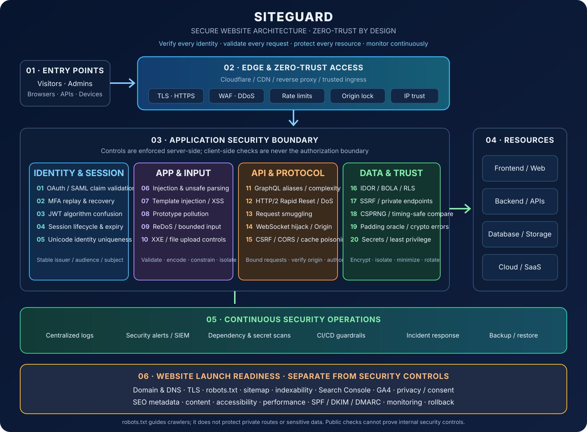

# SiteGuard Playbook

**Don't just vibe code. Secure what you build.**

A practical, evidence-led assessment framework for websites and AI-generated applications. It is designed for architects, engineering leaders, builders and security reviewers who need repeatable checks—not a misleading one-click "secure" score.



The architecture follows a simple rule: verify identity, validate every request, authorize access at the resource boundary, and monitor continuously. The 20 attack scenarios shown in the diagram are mapped into the broader 25-control security checklist below. Not every scenario applies to every stack; applicability must be justified.

## 1. Website Security

Use this 25-point checklist as the main review index. For implementation guidance, verification steps, evidence and remediation, open the [detailed 25-point checklist](website-security/25-point-checklist.md).

| # | Control to verify | Practical verification focus |
|---:|---|---|
| 01 | OAuth / OIDC / SAML identity | Validate issuer, audience, signatures, redirect URI, state, nonce and trusted claims. |
| 02 | MFA / 2FA | One-time codes, replay prevention, throttling and secure recovery. |
| 03 | JWT and session security | Algorithm allowlist, issuer/audience/expiry checks, rotation and revocation. |
| 04 | Authorization / IDOR / BOLA | Server-side object, tenant and role checks on every operation. |
| 05 | Input and Unicode identity | Canonicalization, length limits and uniqueness after normalization. |
| 06 | Injection | Parameterized queries; no unsafe shell or interpreter concatenation. |
| 07 | XSS and template injection | Contextual output encoding and safe template rendering. |
| 08 | CSRF and CORS | CSRF defenses for cookie-authenticated writes; explicit trusted origins. |
| 09 | SSRF | Restrict outbound fetches; block private, loopback, link-local and metadata targets. |
| 10 | File upload security | Verify type/signature/size; isolate storage and scan where appropriate. |
| 11 | DoS and resource exhaustion | WAF/CDN controls, quotas, body limits, concurrency caps and timeouts. |
| 12 | GraphQL security | Bound depth, complexity, aliases, batching and pagination; authorize resolvers. |
| 13 | ReDoS | Avoid catastrophic regular expressions and bound attacker-controlled input. |
| 14 | HTTP request smuggling | Keep proxy/origin request framing consistent; patch edge components. |
| 15 | Proxy and client-IP trust | Accept forwarding headers only from explicitly trusted proxies. |
| 16 | Cache poisoning and leakage | Correct cache keys; prevent shared caching of personalized responses. |
| 17 | Cryptography and timing | Use vetted crypto/CSPRNG, constant-time secret comparison and uniform errors. |
| 18 | Prototype pollution / deserialization | Validate object shapes; avoid unsafe merges and untrusted deserialization. |
| 19 | XXE | Disable external entities and unsafe DTD resolution in XML parsers. |
| 20 | WebSocket security | Authenticate handshake, validate Origin, authorize messages and bound connections. |
| 21 | Security headers | Review CSP, HSTS, nosniff, framing, Referrer-Policy and Permissions-Policy. |
| 22 | TLS, DNS and domain | Valid TLS, renewal, CAA, registrar MFA/lock and no dangling records. |
| 23 | Data and database security | Least privilege, tenant isolation, encryption, retention and managed identity. |
| 24 | Secrets, dependencies and CI/CD | Secret scanning, dependency review, pinned actions and least-privilege workflows. |
| 25 | Logging, monitoring and recovery | Protected/redacted logs, alerts, incident runbooks and tested restore. |

### Important interpretation notes

- A 52-character username is not inherently a vulnerability. The security issue is inconsistent normalization, impersonation through Unicode confusables, or broken uniqueness.
- OAuth account-linking must validate trusted provider claims and stable identifiers; do not trust an email string alone for privileged identity decisions.
- Row-level security (RLS) is database-specific. Verify policies and database roles; do not assume a UI or API filter is equivalent.
- HTTP/2 Rapid Reset is primarily an edge/protocol availability concern. Request smuggling requires careful proxy/origin analysis.
- SAML, GraphQL, XML, WebSockets and uploads are conditional controls. Mark Not Applicable only after confirming the feature is absent.
- A passive public check cannot prove authentication, authorization, database isolation, cryptographic correctness or backup recoverability.

### Result recording

For every check record scope, applicability, method, evidence, status, severity, confidence, owner, remediation and retest. Use the [finding template](examples/finding-template.md).

- **PASS** — test executed and evidence meets the expected result.
- **FAIL** — test demonstrated a control gap.
- **NEEDS MANUAL VERIFICATION** — public observation cannot establish the control.
- **NOT TESTED** — no test performed.
- **NOT APPLICABLE** — confirmed outside the system's feature or technology scope.

Do not convert missing headers or unverified controls into an unsupported claim that a site is exploitable. Do not present an unexplained single security score.

## 2. Website Launch Readiness

This is a separate launch gate—not a subset of the 25 security controls. Keep the checklist visible here and use the [detailed launch guide](website-launch/launch-readiness-checklist.md) for implementation notes.

| # | Launch check | What to confirm |
|---:|---|---|
| 01 | Domain and DNS | Correct A/AAAA/CNAME records; no stale or dangling records. |
| 02 | HTTPS and TLS | Valid certificate, renewal ownership and HTTPS redirect. |
| 03 | robots.txt | Deliberate crawler rules at the root; never use as access control. |
| 04 | sitemap.xml | Valid XML with canonical absolute URLs for indexable pages. |
| 05 | Indexability | No accidental noindex, password wall or crawler block on intended public pages. |
| 06 | Google Search Console | Property ownership verified and sitemap submitted. |
| 07 | Google Analytics 4 | Measurement, event and internal-traffic configuration tested. |
| 08 | Privacy and consent | Privacy/cookie information and consent behaviour reviewed for applicable law. |
| 09 | SEO metadata | Titles, descriptions, canonical URLs, social metadata and appropriate structured data. |
| 10 | Content and navigation | Working links, useful 404, contact details and no placeholder content. |
| 11 | Accessibility | Semantic HTML, keyboard access, labels, focus, contrast and alt text. |
| 12 | Performance | Optimized assets, caching, compression and Core Web Vitals. |
| 13 | Domain email security | SPF, DKIM and DMARC aligned with actual mail senders. |
| 14 | Response headers | CSP, HSTS, nosniff, Referrer-Policy and framing policy. |
| 15 | Monitoring and support | Uptime, error, certificate and security alerts with a named owner. |
| 16 | Backup and rollback | Restore tested separately; deployment rollback and recovery owner documented. |

### Quick start

Python 3.10+, standard library only:

```bash
python scripts/passive_site_check.py https://example.com --i-own-or-have-permission --json
python -m unittest discover -s tests -v
```

The checker makes bounded, read-only GET requests to the supplied origin, `/robots.txt` and `/sitemap.xml`. It does not crawl, authenticate, submit forms, fuzz, exploit, scan ports or inspect private application logic. It is not a penetration test or certification.

### Safe-use boundary

Assess only systems you own or have written permission to test. Define hostnames, routes, environment, test accounts, time window and exclusions. Run active testing only in approved staging environments. Never perform DoS, request-smuggling, destructive or private-network tests against third-party production systems. Never include credentials, tokens, cookies, personal data or private keys in reports.

### Repository map

- `assets/siteguard-security-architecture.svg` — editable vector architecture diagram.
- `website-security/` — detailed 25-point security controls.
- `website-launch/` — launch and discoverability checklist.
- `scripts/` — passive baseline checker.
- `tests/` — unit tests.
- `examples/` — finding template.
- `REFERENCES.md` — primary standards and vendor documentation.
- `AI-SECURITY-REVIEW-PROMPT.md` — source-code review prompt.
- `SECURITY.md` — safe-use and reporting policy.

This independent resource is not an OWASP, NIST, Google, Cloudflare or Microsoft product or certification. See [licensing](LICENSE) and [references](REFERENCES.md).
