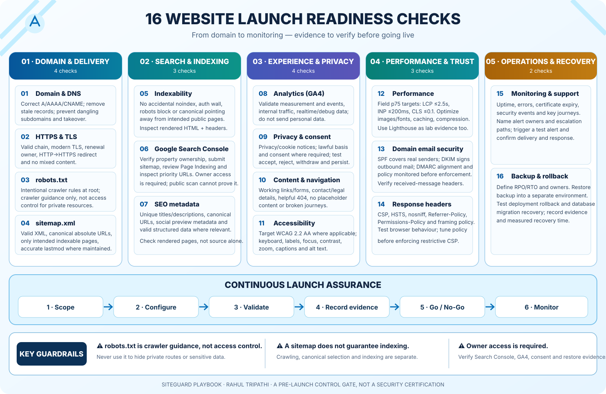

# SiteGuard Playbook

**Don't just vibe code. Secure what you build.**

A practical, evidence-led website assurance checklist for AI-assisted and traditionally developed web applications. It is designed for architects, engineering leaders, developers and security reviewers. It deliberately separates two different decisions:

1. **Website Security** — can the application protect identities, requests, data and resources?
2. **Website Launch Readiness** — is the public website configured, discoverable, usable, performant, supportable and recoverable?

A site can pass one gate and fail the other. Neither gate is a certification.

## At a glance

| Gate | Checklist | Intended outcome |
|---|---:|---|
| Website Security | **25 controls** | Reduce application, identity, API, data, infrastructure and operational risk. |
| Website Launch Readiness | **16 controls** | Verify domain delivery, indexing, privacy, experience, performance and launch operations. |

## 1. Website Security — 25-point checklist

**How to use:** Set the scope first: domains, APIs, environments, user roles, data classes and exclusions. For each control, record applicability, implementation evidence, test result, severity, confidence, owner, remediation and retest. Perform active tests only on systems you own or have explicit written permission to assess—preferably in staging.

| Done | ID | Control | Implement / acceptance criteria | Verify / evidence |
|---|---|---|---|---|
| [ ] | SEC-01 | OAuth / OIDC / SAML identity | Validate signature, trusted issuer, audience, exact redirect URI, state, nonce, expiry and required claims. Pin trusted providers/tenants. | In staging, reject tampered signatures, wrong issuer/audience, mismatched redirect, missing state/nonce and expired assertions/tokens. Keep redacted test evidence. |
| [ ] | SEC-02 | MFA, OTP and recovery | Require MFA for privileged users; enforce one-time use, throttling, secure recovery codes and anti-enumeration. Store recovery material safely. | Reuse a test OTP/recovery code and verify rejection; test throttling, recovery and alternate login paths. |
| [ ] | SEC-03 | JWT and session lifecycle | Allowlist algorithms; validate signature, issuer, audience, expiry and not-before. Use secure cookie attributes where cookies are used; rotate, expire and revoke sessions. | Reject tampered, expired, wrong-audience and revoked test tokens. Verify logout invalidates the server-side session and cookies use appropriate Secure, HttpOnly and SameSite attributes. |
| [ ] | SEC-04 | Authorization, IDOR and BOLA | Enforce default-deny, server-side function-, object-, role- and tenant-level authorization on every read/write path. Middleware is not the only control. | Run an access matrix with two users and two tenants. Cross-user and cross-tenant reads/writes must be denied without leaking data. Test direct API calls, not only UI navigation. |
| [ ] | SEC-05 | Input and Unicode identity | Define length and character policy; normalize identifiers consistently before uniqueness checks; prevent confusable/canonical-equivalent identities from creating ambiguous accounts. | Test boundary lengths, case variants, Unicode normalization and confusables. A 52-character username alone is not a vulnerability; inconsistent identity handling is. |
| [ ] | SEC-06 | Injection (SQL, NoSQL, command) | Use parameterized queries and safe query builders; allowlist command arguments; never concatenate untrusted input into SQL, NoSQL operators or shell commands. | Review source and dependencies; run negative tests with benign fixtures in isolated staging. Confirm inputs remain data, not executable query/command syntax. |
| [ ] | SEC-07 | XSS and template injection | Apply context-aware output encoding; sanitize only explicitly allowed rich text; use safe template APIs; avoid eval or rendering untrusted templates. | Review dangerous rendering sinks. Test stored, reflected and DOM paths with harmless markers in staging; confirm no script execution and correct encoding. |
| [ ] | SEC-08 | CSRF and CORS | Protect cookie-authenticated state changes with CSRF tokens and/or strict Origin checks. Use an explicit CORS origin allowlist; do not combine credentialed requests with wildcard origins. | From an untrusted test origin, verify credentialed reads and state-changing actions are rejected. Confirm allowed origins work and disallowed origins fail. |
| [ ] | SEC-09 | SSRF and server-side URL fetch | Prefer destination allowlists. Restrict schemes; reject loopback, private, link-local and cloud-metadata addresses; validate DNS results and every redirect; defend against IPv4/IPv6 and DNS rebinding. | Unit-test URL parsing and mocked DNS/redirect cases. In authorised staging, prove internal/metadata targets are blocked. Do not probe third-party internal networks. |
| [ ] | SEC-10 | File upload and content handling | Enforce extension allowlists, file-signature checks, size limits, generated names, private/non-executable storage and malware scanning where appropriate. Bound archive expansion and image/document parsing. | Upload harmless wrong-type and oversized fixtures; verify rejection. Confirm stored files cannot execute and access is authorized. |
| [ ] | SEC-11 | DoS and resource exhaustion | Apply edge DDoS protection, per-user/IP quotas, request/body limits, pagination, concurrency caps, timeouts and cost controls. Patch/protect HTTP/2 infrastructure against Rapid Reset class issues. | Review CDN/WAF/origin configuration and vendor advisories. Load-test only with written scope in a controlled environment; never run DoS tests against third-party production. |
| [ ] | SEC-12 | GraphQL query abuse (if used) | Bound query depth, complexity, aliases, batching and pagination; authorize every resolver; apply request cost and rate limits. | Confirm over-limit test queries are rejected and resolver authorization prevents cross-user/tenant access. Mark N/A only if GraphQL is confirmed absent. |
| [ ] | SEC-13 | ReDoS and parser abuse | Avoid catastrophic regular expressions; bound input size and parser work; use safe parsing libraries and execution limits. | Review regexes on attacker-controlled input. Run bounded worst-case unit tests and verify execution stays within an agreed limit. |
| [ ] | SEC-14 | HTTP request smuggling | Keep CDN, load balancer, reverse proxy and origin request-framing behaviour consistent; patch components and avoid ambiguous request parsing. | Review vendor guidance/configuration and assess only in an explicitly authorized staging environment with a defined test plan. Do not send smuggling probes to unrelated production hosts. |
| [ ] | SEC-15 | Client IP and trusted proxy headers | Trust forwarding headers only from known proxy addresses. Strip client-supplied forwarding headers at the trusted edge and establish a single documented client-IP derivation rule. | In staging, spoof X-Forwarded-For and related headers from an untrusted source; verify access controls, audit logs and rate limits do not trust the spoofed value. |
| [ ] | SEC-16 | Cache poisoning and private-data leakage | Define cache keys intentionally; normalize or exclude untrusted headers; prevent shared caching of personalized/authenticated responses; set correct Cache-Control and Vary behaviour. | Compare responses across two test accounts and header variants. Confirm one user's private response is never served to another user or anonymous visitor. |
| [ ] | SEC-17 | Cryptography, randomness and timing | Use vetted cryptographic libraries and authenticated encryption; generate secrets/tokens with a CSPRNG, never Math.random(); use constant-time comparison for secrets and uniform error handling. Avoid custom crypto. | Review code and library usage. Unit-test token generation and error paths. Do not claim a timing or padding-oracle test from casual response-time observations. |
| [ ] | SEC-18 | Prototype pollution and unsafe deserialization | Validate request objects against schemas; reject unexpected keys; avoid unsafe deep merges and prototype mutation; use safe, typed deserialization. | Add unit tests for dangerous keys and malformed objects; confirm untrusted data cannot modify prototypes or privileged configuration. |
| [ ] | SEC-19 | XXE and XML parser security (if XML is accepted) | Disable external entities, external DTD resolution and unsafe XInclude; limit entity expansion and document size. Prefer simpler formats when XML is unnecessary. | Review parser configuration and test benign local XML fixtures. Confirm no external resource resolution occurs. Mark N/A only when XML parsing is absent. |
| [ ] | SEC-20 | WebSocket and real-time channels (if used) | Authenticate handshakes; validate Origin; authorize every message/action; enforce token expiry/revocation, message-size limits, rate limits and connection quotas. | Test rejected origins, unauthenticated handshakes, expired sessions, unauthorized message types and oversized payloads in staging. |
| [ ] | SEC-21 | Browser security headers and content policy | Set an intentional CSP (prefer nonce/hash where feasible), HSTS, X-Content-Type-Options, frame-ancestors/framing policy, Referrer-Policy and Permissions-Policy. | Inspect production response headers and test browser behaviour. Start restrictive CSP in report-only mode where needed; header presence alone does not prove XSS protection. |
| [ ] | SEC-22 | Edge, DNS perimeter and origin protection | Use appropriately configured WAF/DDoS controls; restrict origin access to trusted ingress where feasible; protect admin surfaces; disable unused services and prevent direct-origin bypass. | Review CDN/WAF/firewall rules, origin ACL/tunnel configuration, exposed ports and administrative access. Verify allowed ingress and denied bypass using authorized infrastructure evidence. |
| [ ] | SEC-23 | Data, database and tenant isolation | Apply least-privilege database identities, tenant/object isolation, encryption in transit/at rest, secrets management, data minimization and retention rules. Use managed identity where supported. | Review roles, network access and key ownership. Run cross-tenant negative tests. Verify encryption and retention settings from provider/configuration evidence; RLS applies only to databases that implement it. |
| [ ] | SEC-24 | Secrets, dependencies, CI/CD and AI tooling | Keep secrets out of code/client bundles; scan secrets and dependencies; maintain lockfiles/SBOM; pin workflow actions; minimize CI permissions; protect branches/deployments; restrict AI-agent tools and production approvals. | Run secret/dependency/code scans. Review workflow permissions, action pinning, protected environments and cloud federation. Confirm no long-lived credentials or unreviewed agent changes reach production. |
| [ ] | SEC-25 | Logging, monitoring, incident response and recovery | Centralize security-relevant logs; redact credentials/tokens and unnecessary personal data; alert on suspicious events; maintain incident runbooks and tested backup/restore procedures. | Trigger a test alert, confirm ownership/escalation, review redacted logs and restore a backup into a separate environment. Record recovery evidence and lessons learned. |

### Security result rules

- **PASS** — the control was tested and evidence meets the expected result.
- **FAIL** — a repeatable test demonstrated a control gap.
- **NEEDS MANUAL VERIFICATION** — the control requires source, cloud-console, identity-provider, database or owner access.
- **NOT TESTED** — no test was performed.
- **NOT APPLICABLE** — the relevant feature/technology is confirmed absent, with a short rationale.

Keep **status, severity and confidence separate**. A missing header is not automatically an exploitable vulnerability. A passive public scan cannot prove authentication, authorization, tenant isolation, cryptographic correctness, secure CI permissions or backup recoverability.

The 20 attack scenarios highlighted in the original social-media reference (Rapid Reset, username edge cases, SAML/OAuth, GraphQL, 2FA replay, ReDoS, JWT confusion, request smuggling, cache poisoning, spoofed IP headers, RLS/view bypass, weak tokens, timing/padding oracles, prototype pollution, template injection, XXE, WebSocket and Unicode identity) are represented in the broader controls above. Several are technology-specific or infrastructure-level, not universal website checks.

## 2. Website Launch Readiness — 16-point checklist

This is a **separate launch gate**. It verifies domain delivery, search/indexing, user experience, privacy, performance and operational readiness. It is not a substitute for the security assessment above.

| Done | ID | Launch control | Configure / acceptance criteria | Verify / evidence |
|---|---|---|---|---|
| [ ] | LAUNCH-01 | Domain and DNS | Correct A/AAAA/CNAME records; remove stale records and dangling subdomains; registrar MFA/lock and renewal owner documented. | Query authoritative DNS; compare with hosting configuration; review registrar and DNS ownership evidence. |
| [ ] | LAUNCH-02 | HTTPS and TLS | Valid certificate chain, hostname match, renewal monitoring, HTTP-to-HTTPS redirect and no mixed content. | Browser/TLS inspection; test redirect and certificate expiry alert. |
| [ ] | LAUNCH-03 | robots.txt | Deliberate crawler rules at /robots.txt; allow intended public content and required assets. | GET the file and review directives against launch intent. Remember: robots.txt is crawler guidance, **not access control**. |
| [ ] | LAUNCH-04 | sitemap.xml | Valid XML at the published location; absolute canonical URLs; include intended indexable pages only; maintain lastmod accurately where used. | Validate XML, fetch every listed URL and confirm it returns the intended canonical page/status. Submission does not guarantee indexing. |
| [ ] | LAUNCH-05 | Indexability and canonicalization | No accidental noindex, login wall or robots block on intended public pages; canonical URLs point to the preferred version. | Inspect rendered meta robots, X-Robots-Tag, canonical tags and robots rules. Use Search Console URL Inspection for priority URLs. |
| [ ] | LAUNCH-06 | Google Search Console | Verify the correct Domain or URL-prefix property; submit sitemap; review indexing/security/manual-action reports. | Owner confirms property ownership and sitemap processing in Search Console. A public scan cannot prove account ownership. |
| [ ] | LAUNCH-07 | Google Analytics 4 | Configure the correct measurement property, useful events/conversions and internal-traffic rules; do not send personal or sensitive data. | Use Realtime/DebugView and test events. Verify account/property owner-side. |
| [ ] | LAUNCH-08 | Privacy and consent | Publish accurate privacy/cookie disclosures; configure consent and tag behaviour where required by applicable law and audience location; support withdrawal. | Test accept, reject, withdraw and persistence. Check tags before/after consent. Obtain legal review where obligations are unclear. |
| [ ] | LAUNCH-09 | SEO and social metadata | Unique useful titles/descriptions; canonical URLs; Open Graph/social preview metadata; relevant structured data with no fabricated claims. | Inspect rendered HTML and share previews; validate structured data with relevant official tools. |
| [ ] | LAUNCH-10 | Content, navigation and forms | Working navigation, internal links, contact/legal details, helpful 404, no placeholder text; forms validate, deliver and show clear errors/success. | Crawl the owned site, manually complete key journeys and test form delivery/spam handling without real customer data. |
| [ ] | LAUNCH-11 | Accessibility | Use WCAG 2.2 AA as a practical target where applicable; semantic structure, labels, keyboard operation, visible focus, contrast, zoom, captions and meaningful alt text. | Combine automated scans with manual keyboard and screen-reader spot checks. Automated scores alone do not establish conformance. |
| [ ] | LAUNCH-12 | Performance and Core Web Vitals | Optimize critical images/fonts, caching, compression and rendering. Good field targets at the 75th percentile: LCP ≤2.5s, INP ≤200ms, CLS ≤0.1. | Use PageSpeed Insights/CrUX field data where available and Lighthouse lab tests. Segment mobile and desktop; lab results are not field data. |
| [ ] | LAUNCH-13 | Domain email authentication | SPF authorizes real senders; DKIM signs outbound mail; DMARC alignment/reporting is configured and policy is advanced deliberately after monitoring. | Inspect DNS and received-message authentication headers. Avoid publishing multiple SPF records or enforcing a policy before legitimate senders are known. |
| [ ] | LAUNCH-14 | Response headers | Production headers implement the security policy: CSP, HSTS, nosniff, Referrer-Policy, Permissions-Policy and framing restrictions. | Inspect responses on important routes and validate browser compatibility. This overlaps security control SEC-21; record one shared evidence set. |
| [ ] | LAUNCH-15 | Monitoring and support | Uptime, errors, certificate expiry and security alerts have named owners, thresholds, escalation and support contact. | Trigger a test alert; confirm delivery, acknowledgement and runbook action. |
| [ ] | LAUNCH-16 | Backup, restore and rollback | Define RPO/RTO; maintain protected backups; document release rollback and database migration recovery. | Restore into a separate environment and execute a rollback drill. Record measured recovery time and owner sign-off. |

### Launch decision

Do not declare a site ready from a scanner score alone. Require:

- No unresolved critical security finding; high-risk exceptions have an explicit owner and documented risk acceptance.
- All applicable launch controls have evidence or a named, time-bound exception.
- Key user journeys and accessibility checks are tested.
- Backup restoration and deployment rollback have been exercised.
- Monitoring and escalation ownership are confirmed.
- A named release owner records the go/no-go decision.

## How to run the included passive baseline checker

Python 3.10+; standard library only:

~~~bash
python scripts/passive_site_check.py https://example.com --i-own-or-have-permission --json
python -m unittest discover -s tests -v
~~~

The utility performs a bounded, read-only baseline against the supplied origin, /robots.txt and /sitemap.xml. It does not crawl, authenticate, submit forms, follow redirects, fuzz, exploit, scan ports or test private application logic. It is **not** a penetration test, a complete launch audit or a security certification. Treat its output as observations requiring review.

## Standards and source references

- [OWASP ASVS 5.0.0](https://asvs.owasp.org/) — application security verification requirements.
- [OWASP Top 10:2025](https://owasp.org/Top10/2025/) — web application risk awareness.
- [OWASP API Security](https://owasp.org/www-project-api-security/) — API-specific risk guidance.
- [OWASP Web Security Testing Guide](https://owasp.org/www-project-web-security-testing-guide/) — authorized testing methodology.
- [NIST Secure Software Development Framework (SSDF)](https://csrc.nist.gov/pubs/sp/800/218/final) — secure development lifecycle practices.
- [Google robots.txt guidance](https://developers.google.com/search/docs/crawling-indexing/robots/intro) and [sitemap guidance](https://developers.google.com/search/docs/crawling-indexing/sitemaps/overview).
- [Google Search Console verification](https://support.google.com/webmasters/answer/9008080).
- [Core Web Vitals](https://web.dev/articles/vitals) — field performance metrics and thresholds.
- [WCAG 2.2](https://www.w3.org/TR/WCAG22/) — accessibility success criteria.

This independent playbook is not an OWASP, NIST, Google, Cloudflare or Microsoft product or certification. Standards and vendor documentation may evolve; verify the current source before using this checklist for contractual, regulatory or high-assurance decisions.

## Repository contents

- assets/siteguard-security-architecture.svg — 20-scenario security architecture reference.
- assets/siteguard-launch-readiness.svg — 16-check launch readiness architecture.
- website-security/25-point-checklist.md — detailed security checklist reference.
- website-launch/launch-readiness-checklist.md — detailed launch checklist reference.
- scripts/ and tests/ — passive utility and tests.
- examples/finding-template.md — evidence and remediation record.
- AI-SECURITY-REVIEW-PROMPT.md — defensive source-code review prompt.
- SECURITY.md — authorized-use and safe-reporting policy.

Assess only systems you own or have explicit written permission to test. Define hosts, routes, environment, accounts, window and exclusions. Never put secrets, tokens, cookies, personal data or private keys in reports.
